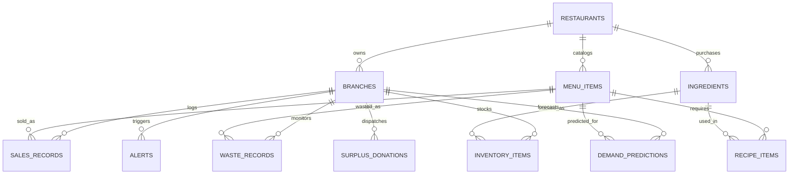

# Database Schema Documentation

## Supabase PostgreSQL Architecture

The database is structured as a normalized relational schema with full foreign key constraints, performance indexes, and Row Level Security (RLS) policies.

### 1. Entity-Relationship Overview

### 2. Core Tables
1. **restaurants**: Parent corporate or individual brand entity (`id`, `name`, `currency`, `contact_email`).
2. **branches**: Location/branch records (`id`, `restaurant_id`, `name`, `address`, `city`, `timezone`, `opening_time`).
3. **menu_items**: Finished customer-facing dishes (`id`, `restaurant_id`, `name`, `category`, `selling_price`, `preparation_cost`, `shelf_life_hours`).
4. **ingredients**: Raw stock procurement items (`id`, `restaurant_id`, `name`, `category`, `unit`, `unit_cost`, `shelf_life_days`).
5. **recipe_items**: Bill of Materials (BOM) linking portions to raw ingredients (`id`, `menu_item_id`, `ingredient_id`, `quantity_required`, `unit`).
6. **inventory_items**: Branch stock levels (`id`, `branch_id`, `ingredient_id`, `current_stock`, `safety_stock`, `reorder_point`, `expiry_date`).
7. **sales_records**: Historical & real-time transactions (`id`, `branch_id`, `menu_item_id`, `sale_date`, `sale_hour`, `quantity_sold`, `unit_price`, `weather_temp`, `rainfall_mm`).
8. **waste_records**: Kitchen shift waste tracking (`id`, `branch_id`, `menu_item_id`, `record_date`, `prepared_quantity`, `sold_quantity`, `remaining_quantity`, `wasted_quantity`, `waste_percentage`, `waste_reason`, `cost_wasted`, `corrective_action_recommended`).
9. **demand_predictions**: Daily model inferences and explainability weights (`id`, `branch_id`, `menu_item_id`, `target_date`, `predicted_demand`, `confidence_lower`, `confidence_upper`, `model_name`, `model_version`, `feature_contributions`).
10. **alerts**: Real-time notifications (`id`, `branch_id`, `alert_type`, `severity`, `title`, `message`, `status`).
11. **surplus_donations**: Food-safety verified redistribution tracking (`id`, `branch_id`, `menu_item_id`, `surplus_quantity`, `food_safe_certified`, `certified_by`, `recipient_ngo`, `pickup_status`, `impact_meals_saved`, `carbon_avoided_kg`).
12. **model_evaluations**: Offline and continuous validation metrics (`id`, `model_name`, `mae`, `rmse`, `mape`, `r2_score`, `sample_count`).

### 3. Migrations
- `supabase/migrations/001_initial_schema.sql`
- `supabase/migrations/002_indexes_and_constraints.sql`
- `supabase/migrations/003_rls_and_security.sql`
